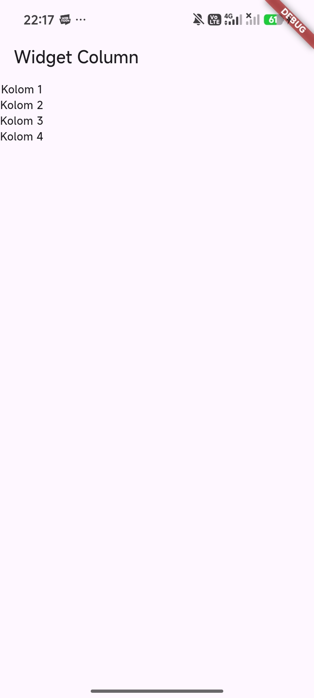
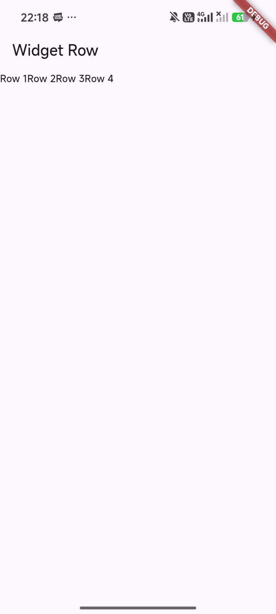
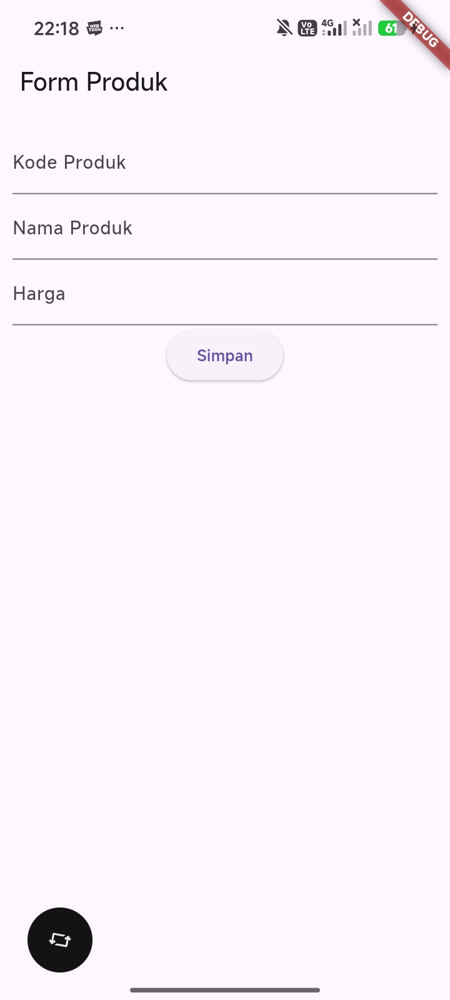
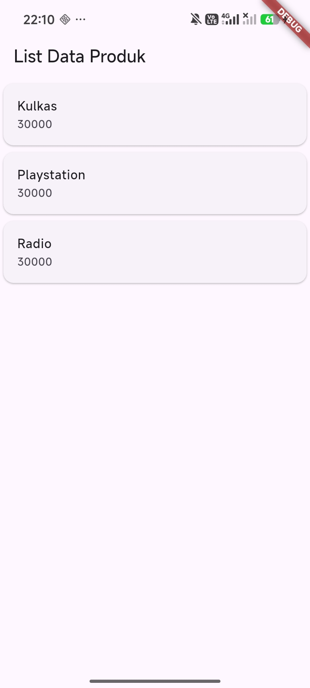
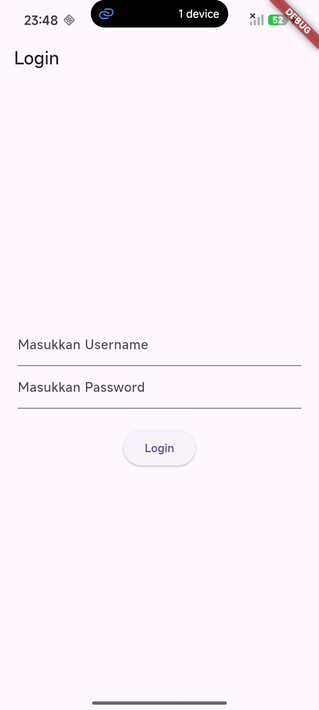
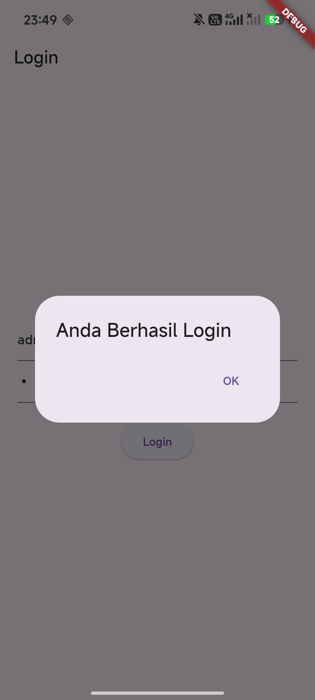
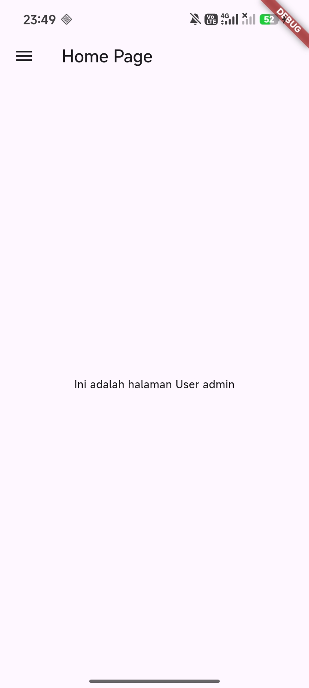
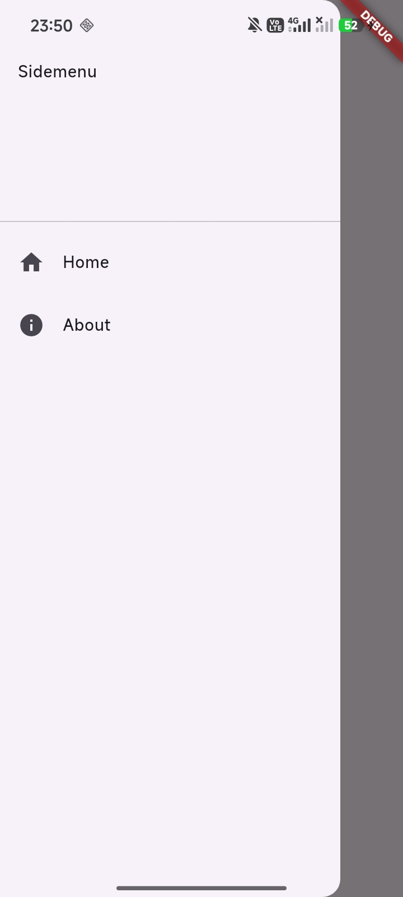

# Praktikum Pemrograman Mobile - Flutter

Repositori ini berisi kumpulan tugas dan implementasi modul praktikum pada mata kuliah **Praktikum Pemrograman Mobile**.

---

## Identitas Praktikan

- **Nama       :** Amalia Maharani Andessy
- **NIM        :** H1D024032
- **Shift KRS  :** E
- **Shift Baru :** F

---

## Daftar Isi
1. [Modul 1: Bahasa Pemrograman Dart (Struktur Data Queue)](#modul-1-bahasa-pemrograman-dart)
2. [Modul 2: Pengenalan dan Desain Framework Flutter](#modul-2-pengenalan-dan-desain-framework-flutter)
3. [Modul 3: Routes, Side Menu, Login dan Local Storage Framework Flutter](#modul-3-routes-side-menu-login-dan-local-storage-framework-flutter)

---

# Modul 1: Bahasa Pemrograman Dart

## Deskripsi Program
Program ini mengimplementasikan struktur data antrean (**Queue**) menggunakan bahasa pemrograman **Dart**. Queue adalah struktur data linier yang bekerja dengan prinsip **FIFO (First In, First Out)**, yaitu elemen yang pertama kali dimasukkan ke dalam antrean akan menjadi elemen yang pertama kali dikeluarkan.

Pada project ini dibuat:
1. **Class `Queue`** pada `lib/queue.dart` yang memuat logika struktur data antrean.
2. **Program Utama** pada `lib/main.dart` untuk mendemonstrasikan proses penambahan data (*enqueue*), pengambilan data (*dequeue*), hingga pengujian kondisi saat antrean kosong.

---

## Komponen dan Logika Program

### 1. Class `Queue` (`lib/queue.dart`)
- **`items` (`List<dynamic>`)**: Berfungsi sebagai wadah penyimpanan elemen-elemen di dalam antrean.
- **`enqueue(dynamic item)`**: Menambahkan elemen baru ke posisi paling belakang antrean menggunakan method bawaan `items.add(item)`.
- **`dequeue()`**: Mengambil dan menghapus elemen yang berada di posisi terdepan menggunakan `items.removeAt(0)`. Jika antrean kosong, program akan menampilkan pesan peringatan dan mengembalikan nilai `null`.
- **`tampilkanQueue()`**: Menampilkan status isi antrean saat ini ke konsol/terminal.
- **`isEmpty` & `size`**: Getter untuk mengecek apakah antrean kosong dan menghitung jumlah elemen dalam antrean.

### 2. Program Utama (`lib/main.dart`)
- Melakukan inisialisasi objek `Queue`.
- Melakukan *enqueue* beberapa data (`"A"`, `"B"`, `"C"`).
- Melakukan *dequeue* elemen pertama (`"A"`) untuk membuktikan prinsip FIFO.
- Menambahkan data baru (`"D"`) di belakang antrean yang tersisa (`["B", "C", "D"]`).
- Mengeluarkan sisa seluruh elemen hingga antrean kosong.
- Menguji pemanggilan `dequeue()` ketika antrean kosong untuk memastikan penanganan kondisi batas (*edge case*).

---

## Struktur Folder Modul 1

```text
h1d024032-praktikum-mobile-flutter/
├── lib/
│   ├── main.dart
│   └── queue.dart
├── screenshots/
│   └── Pertemuan 1.png
```

---

## Cara Menjalankan Program Modul 1

Pastikan Dart SDK atau Flutter SDK sudah terpasang dan terdaftar pada PATH sistem. Buka terminal pada direktori root project, kemudian jalankan perintah berikut:

```bash
dart run lib/main.dart
```

---

## Hasil Output Modul 1

Berikut adalah hasil tangkapan layar output saat program dijalankan:


### Teks Output:
```text
==================================================
PRAKTIKUM PEMROGRAMAN MOBILE - MODUL 1 (DART)
IMPLEMENTASI STRUKTUR DATA QUEUE (FIFO)
Nama : Amalia Maharani Andessy
NIM  : H1D024032
==================================================

--- 1. Proses Enqueue Elemen ---
Enqueue (A) berhasil ditambahkan ke antrean.
Enqueue (B) berhasil ditambahkan ke antrean.
Enqueue (C) berhasil ditambahkan ke antrean.
Isi Queue saat ini: [A, B, C]
Jumlah antrean: 3

--- 2. Proses Dequeue (Prinsip FIFO) ---
Data yang diambil: A
Isi Queue saat ini: [B, C]
Jumlah antrean saat ini: 2

--- 3. Menambahkan Elemen Baru ---
Enqueue (D) berhasil ditambahkan ke antrean.
Isi Queue saat ini: [B, C, D]
Jumlah antrean saat ini: 3

--- 4. Mengambil Sisa Elemen Hingga Antrean Kosong ---
Data yang diambil: B
Data yang diambil: C
Data yang diambil: D
Isi Queue saat ini: []

--- 5. Uji Coba Dequeue Pada Antrean Kosong ---
Peringatan: Queue kosong, tidak ada elemen yang dapat diambil.

==================================================
Program Selesai.
==================================================
```

---
---

# Modul 2: Pengenalan dan Desain Framework Flutter

## Deskripsi Praktikum
Praktikum Modul 2 berfokus pada pengenalan kerangka kerja (framework) **Flutter** dan bahasa pemrograman **Dart** untuk pengembangan antarmuka pengguna (UI) mobile multiplatform. Pada praktikum ini dipelajari:
1. Konsep **StatelessWidget** (komponen statis) dan **StatefulWidget** (komponen dinamis dengan state internal).
2. Pemisahan kode ke dalam multiple file `.dart` untuk modularitas dan keterbacaan kode (*clean code*).
3. Tata letak (layout) dasar Flutter: **Column** (susunan vertikal) dan **Row** (susunan horizontal).
4. Pembuatan formulir input data (**Form Produk**) menggunakan `TextField` dan `TextEditingController`.
5. Pengiriman data antar halaman (*Navigation / Routing*) menggunakan `Navigator.push` dan `MaterialPageRoute` menuju halaman **Detail Produk**.
6. Menampilkan koleksi data menggunakan **ListView**, **Card**, dan **ListTile** (**List Data Produk**).

---

## Struktur Folder Project Modul 2

```text
modul2/
├── android/
│   ├── app/
│   └── gradle.properties
├── lib/
│   ├── hello_world.dart       # Latihan StatelessWidget dasar Hello World
│   ├── column_widget.dart     # Latihan tata letak Column (vertikal)
│   ├── row_widget.dart        # Latihan tata letak Row (horizontal)
│   ├── main.dart              # Entry point aplikasi Flutter (MaterialApp)
│   └── ui/
│       ├── produk_form.dart   # Form input data produk (StatefulWidget)
│       ├── produk_detail.dart # Menampilkan detail produk yang dikirim
│       └── produk_page.dart   # Daftar produk dengan ListView & Card
├── pubspec.yaml
└── README.md
```

---

## Rincian Komponen & File Latihan

### 1. `lib/hello_world.dart` (Modul Hal. 16–18)
- Berisi class `HelloWorld` turunan dari `StatelessWidget`.
- Mengimplementasikan struktur dasar Material Design: `Scaffold`, `AppBar` bertuliskan *"Belajar Flutter"*, serta `Center` berisi `Text("Hello World")`.

### 2. `lib/column_widget.dart` (Modul Hal. 19–20)
- Berisi class `ColumnWidget` turunan dari `StatelessWidget`.
- Menggunakan widget `Column` dengan properti `children` yang menyusun 4 buah `Text` (`Kolom 1` sampai `Kolom 4`) secara menurun/vertikal.

### 3. `lib/row_widget.dart` (Modul Hal. 21)
- Berisi class `RowWidget` turunan dari `StatelessWidget`.
- Menggunakan widget `Row` dengan properti `children` yang menyusun 4 buah `Text` (`Row 1` sampai `Row 4`) secara mendatar/horizontal.

### 4. `lib/ui/produk_form.dart` & `lib/ui/produk_detail.dart` (Modul Hal. 21–24)
- **`ProdukForm` (`StatefulWidget`)**:
  - Menyediakan input teks untuk `Kode Produk`, `Nama Produk`, dan `Harga` menggunakan `TextField`.
  - Mengelola nilai input menggunakan `TextEditingController` (`_kodeProdukController`, `_namaProdukController`, `_hargaProdukController`).
  - Memiliki tombol `ElevatedButton` *"Simpan"* yang mem-parsing harga ke integer dan mengirimkan data ke halaman `ProdukDetail` via `Navigator.push(MaterialPageRoute(...))`.
- **`ProdukDetail` (`StatelessWidget`)**:
  - Menerima parameter `kodeProduk`, `namaProduk`, dan `harga`.
  - Menampilkan kembali data yang di-inputkan user dalam format rapi di dalam `Scaffold`.

### 5. `lib/ui/produk_page.dart` (Modul Hal. 25–26)
- Berisi class `ProdukPage` turunan dari `StatefulWidget`.
- Menggunakan `ListView` dengan widget `Card` dan `ListTile` untuk menyajikan daftar produk secara terstruktur (*Kulkas*, *Playstation*, *Radio* beserta harganya).

### 6. `lib/main.dart` (Modul Hal. 26)
- Fungsi `main()` menjalankan root widget `MyApp`.
- Pada properti `home:`, secara default diatur memanggil `const ProdukPage()` sesuai arahan akhir Modul 2.

---

## Cara Menjalankan Program Modul 2

1. Buka terminal dan masuk ke folder `modul2`:
   ```powershell
   cd modul2
   ```
2. Pastikan perangkat (HP fisik via USB debugging atau emulator) sudah terhubung:
   ```powershell
   flutter devices
   ```
3. Jalankan aplikasi:
   ```powershell
   flutter run
   ```
   *Atau buka file `modul2/lib/main.dart` di VS Code / Antigravity IDE lalu tekan **F5 / Run Without Debugging**.*

### Mengganti Halaman Tampilan di `main.dart`
Untuk melihat pengujian dari masing-masing langkah modul, ubah properti `home:` pada file `modul2/lib/main.dart`:

```dart
// Pilih salah satu halaman yang ingin ditampilkan:
home: const HelloWorld(),    // Menampilkan latihan Hello World (Hal. 16-18)
home: const ColumnWidget(),  // Menampilkan latihan Column Widget (Hal. 19-20)
home: const RowWidget(),     // Menampilkan latihan Row Widget (Hal. 21)
home: const ProdukForm(),    // Menampilkan latihan Form Input Produk (Hal. 21-24)
home: const ProdukPage(),    // Menampilkan latihan ListView Produk (Hal. 25-26 - Aktif)
```

---

## Hasil Tampilan Praktikum Modul 2

Simpan tangkapan layar (screenshot) aplikasi pada folder `screenshots/` dengan nama file berikut:

### 1. Tampilan Hello World (Modul Hal. 17)
> Letakkan screenshot di: `screenshots/modul2_hello_world.png`


### 2. Tampilan Widget Column (Modul Hal. 20)
> Letakkan screenshot di: `screenshots/modul2_column.png`



### 3. Tampilan Widget Row (Modul Hal. 21)
> Letakkan screenshot di: `screenshots/modul2_row.png`



### 4. Tampilan Form Input Produk (Modul Hal. 22–23)
> Letakkan screenshot di: `screenshots/modul2_form.png`



### 5. Tampilan Detail Produk Setelah Input (Modul Hal. 24)
> Letakkan screenshot di: `screenshots/modul2_detail.png`


### 6. Tampilan ListView Data Produk (Modul Hal. 26)
> Letakkan screenshot di: `screenshots/modul2_listview.png`



---
---

# Modul 3: Routes, Side Menu, Login dan Local Storage Framework Flutter

## Deskripsi Praktikum
Praktikum Modul 3 berfokus pada implementasi sistem autentikasi pengguna, penyimpanan data lokal di perangkat, dan pembuatan navigasi menu samping (*drawer / sidemenu*). Materi utama yang dipelajari meliputi:
1. **Autentikasi Sederhana (Login System)**:
   - Membuat halaman login dengan input `username` dan `password` (`obscureText: true`).
   - Simulasi validasi kredensial (username: `admin` dan password: `admin`).
   - Menampilkan umpan balik menggunakan dialog peringatan (`AlertDialog`).
2. **Local Storage Menggunakan `shared_preferences`**:
   - Menyimpan data username pengguna ke penyimpanan lokal perangkat (`prefs.setString('username', ...)`).
   - Membaca kembali data username yang tersimpan untuk ditampilkan pada halaman beranda (`prefs.getString('username')`).
3. **Navigasi Antar Halaman (*Routing*)**:
   - Berpindah antar halaman aplikasi menggunakan `Navigator.push` dan `MaterialPageRoute`.
4. **Side Menu / Drawer (*Navigation Drawer*)**:
   - Membuat menu navigasi samping (`Drawer`) dengan `DrawerHeader` dan beberapa `ListTile`.
   - Menghubungkan menu navigasi ke halaman **Home** dan **About**.

---

## Struktur Folder Project Modul 3

```text
modul3/
├── android/
│   ├── app/
│   └── gradle.properties      # Konfigurasi memori JVM Gradle aman (2GB)
├── lib/
│   ├── main.dart              # Entry point aplikasi (MaterialApp & rute awal)
│   ├── login_page.dart        # Halaman Login & penyimpanan SharedPreferences
│   ├── home_page.dart         # Halaman Utama (menampilkan user & drawer)
│   ├── sidemenu.dart          # Komponen Drawer menu samping (Home & About)
│   └── about_page.dart        # Halaman About dengan komponen Drawer
├── pubspec.yaml               # Dependensi shared_preferences
└── README.md                  # Dokumentasi project Modul 3
```

---

## Rincian File dan Logika Program

### 1. `pubspec.yaml`
Menambahkan dependensi pustaka penyimpanan lokal:
```yaml
dependencies:
  flutter:
    sdk: flutter
  cupertino_icons: ^1.0.8
  shared_preferences: ^2.0.17
```

### 2. `lib/login_page.dart` (Modul Hal. 2–5)
- Menggunakan `StatefulWidget` dengan dua `TextEditingController`:
  - `_usernameController`: Input username.
  - `_passwordController`: Input password.
- **Fungsi `_saveUsername()`**:
  Menyimpan username ke penyimpanan lokal menggunakan `SharedPreferences`:
  ```dart
  void _saveUsername() async {
    SharedPreferences prefs = await SharedPreferences.getInstance();
    prefs.setString('username', _usernameController.text);
  }
  ```
- **Fungsi `_showDialog()`**:
  Menampilkan pop-up peringatan interaktif (`AlertDialog`).
- **Logika Tombol Login**:
  Jika kredensial adalah `admin` / `admin`, data username disimpan dan pengguna dialihkan ke `HomePage`. Jika salah, muncul peringatan dan tetap berada di `LoginPage`.

### 3. `lib/home_page.dart` (Modul Hal. 7–8)
- Menampilkan pesan sambutan yang memuat username aktif dari penyimpanan lokal:
  ```dart
  Text('Ini adalah halaman User $namauser')
  ```
- Mengambil username saat inisialisasi (`_loadUsername()`) dengan `prefs.getString('username')`.
- Memasang komponen menu samping pada properti `drawer: const Sidemenu()`.

### 4. `lib/sidemenu.dart` (Modul Hal. 9, 11)
- Berisi widget `Drawer` dengan `ListView` yang memuat:
  - `DrawerHeader`: Menampilkan judul menu *"Sidemenu"*.
  - `ListTile` Home: Navigasi menuju `HomePage`.
  - `ListTile` About: Navigasi menuju `AboutPage`.

### 5. `lib/about_page.dart` (Modul Hal. 10)
- Menampilkan halaman informasi dengan teks *"Ini adalah halaman About"*.
- Tetap menyertakan `drawer: const Sidemenu()` agar navigasi samping tetap konsisten di seluruh halaman aplikasi.

### 6. `lib/main.dart` (Modul Hal. 6–7)
- Menjalankan root widget `MyApp` dengan halaman awal diarahkan langsung ke `LoginPage`:
  ```dart
  home: const LoginPage(),
  ```

---

## Cara Menjalankan Aplikasi Modul 3

1. Buka terminal pada folder `modul3`:
   ```powershell
   cd modul3
   ```
2. Jalankan aplikasi ke perangkat HP yang terhubung atau emulator:
   ```powershell
   flutter run
   ```
   *Atau buka file `modul3/lib/main.dart` di VS Code / Antigravity IDE, lalu tekan tombol **F5** (Run Without Debugging).*
3. Masuk dengan akun uji coba:
   - **Username :** `admin`
   - **Password :** `admin`

---

## Hasil Tangkapan Layar (Screenshots) Modul 3

Simpan hasil screenshot dari layar HP ke dalam folder `screenshots/` di root repositori dengan format nama file berikut:

### 1. Halaman Login (Modul Hal. 6)
> Letakkan screenshot di: `screenshots/modul3_login.png`



### 2. Dialog Berhasil Login
> Letakkan screenshot di: `screenshots/modul3_dialog_login.png`



### 3. Halaman Home Page (Modul Hal. 12)
> Letakkan screenshot di: `screenshots/modul3_home.png`



### 4. Tampilan Side Menu / Drawer Terbuka (Modul Hal. 12)
> Letakkan screenshot di: `screenshots/modul3_sidemenu.png`



### 5. Halaman About Page
> Letakkan screenshot di: `screenshots/modul3_about.png`


