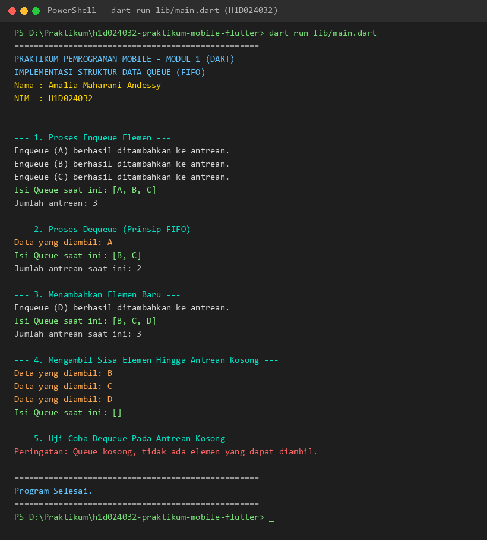

# Implementasi Struktur Data Queue Menggunakan Dart

Project ini dibuat untuk memenuhi tugas **Modul 1: Bahasa Pemrograman Dart** pada mata kuliah **Praktikum Pemrograman Mobile**.

---

## Identitas Praktikan

- **Nama       :** Amalia Maharani Andessy
- **NIM        :** H1D024032
- **Shift KRS  :** E
- **Shift Baru :** F

---

## Deskripsi Program

Program ini mengimplementasikan struktur data antrean (**Queue**) menggunakan bahasa pemrograman **Dart**. Queue adalah struktur data linier yang bekerja dengan prinsip **FIFO (First In, First Out)**, yaitu elemen yang pertama kali dimasukkan ke dalam antrean akan menjadi elemen yang pertama kali dikeluarkan.

Pada project ini dibuat:
1. **Class `Queue`** pada `lib/queue.dart` yang memuat logika struktur data antrean.
2. **Program Utama** pada `lib/main.dart` untuk mendemonstrasikan proses penambahan data (*enqueue*), pengambilan data (*dequeue*), hingga pengujian kondisi saat antrean kosong.

---

## Komponen dan Logika Program

### 1. Class `Queue` (`lib/queue.dart`)
- **`items` (`List<dynamic>`)**: Berfungsi sebagai wadah penyimpanan elemen-elemen di dalam antrean.
- **`enqueue(dynamic item)`**: Menambahkan elemen baru ke posisi paling belakang antrean menggunakan method bawaan `items.add(item)`.
- **`dequeue()`**: Mengambil dan menghapus elemen yang berada di posisi terdepan menggunakan `items.removeAt(0)`. Jika antrean kosong, program akan menampilkan pesan peringatan dan mengembalikan nilai `null`.
- **`tampilkanQueue()`**: Menampilkan status isi antrean saat ini ke konsol/terminal.
- **`isEmpty` & `size`**: Getter untuk mengecek apakah antrean kosong dan menghitung jumlah elemen dalam antrean.

### 2. Program Utama (`lib/main.dart`)
- Melakukan inisialisasi objek `Queue`.
- Melakukan *enqueue* beberapa data (`"A"`, `"B"`, `"C"`).
- Melakukan *dequeue* elemen pertama (`"A"`) untuk membuktikan prinsip FIFO.
- Menambahkan data baru (`"D"`) di belakang antrean yang tersisa (`["B", "C", "D"]`).
- Mengeluarkan sisa seluruh elemen hingga antrean kosong.
- Menguji pemanggilan `dequeue()` ketika antrean kosong untuk memastikan penanganan kondisi batas (*edge case*).

---

## Struktur Folder Project

```text
h1d024032-praktikum-mobile-flutter/
├── .gitignore
├── analysis_options.yaml
├── CHANGELOG.md
├── pubspec.yaml
├── lib/
│   ├── main.dart
│   └── queue.dart
├── screenshots/
│   └── output.png
└── README.md
```

---

## Cara Menjalankan Program

Pastikan Dart SDK atau Flutter SDK sudah terpasang dan terdaftar pada PATH sistem. Buka terminal pada direktori root project, kemudian jalankan perintah berikut:

```bash
dart run lib/main.dart
```

---

## Hasil Output Eksekusi

Berikut adalah hasil tangkapan layar (screenshot) output terminal saat program dijalankan:



### Teks Output:
```text
==================================================
PRAKTIKUM PEMROGRAMAN MOBILE - MODUL 1 (DART)
IMPLEMENTASI STRUKTUR DATA QUEUE (FIFO)
Nama : Amalia Maharani Andessy
NIM  : H1D024032
==================================================

--- 1. Proses Enqueue Elemen ---
Enqueue (A) berhasil ditambahkan ke antrean.
Enqueue (B) berhasil ditambahkan ke antrean.
Enqueue (C) berhasil ditambahkan ke antrean.
Isi Queue saat ini: [A, B, C]
Jumlah antrean: 3

--- 2. Proses Dequeue (Prinsip FIFO) ---
Data yang diambil: A
Isi Queue saat ini: [B, C]
Jumlah antrean saat ini: 2

--- 3. Menambahkan Elemen Baru ---
Enqueue (D) berhasil ditambahkan ke antrean.
Isi Queue saat ini: [B, C, D]
Jumlah antrean saat ini: 3

--- 4. Mengambil Sisa Elemen Hingga Antrean Kosong ---
Data yang diambil: B
Data yang diambil: C
Data yang diambil: D
Isi Queue saat ini: []

--- 5. Uji Coba Dequeue Pada Antrean Kosong ---
Peringatan: Queue kosong, tidak ada elemen yang dapat diambil.

==================================================
Program Selesai.
==================================================
```

---

## Analisis dan Kesimpulan

1. **Penerapan Prinsip FIFO**:
   Ketika elemen `"A"`, `"B"`, dan `"C"` dimasukkan secara berurutan, pemanggilan `dequeue()` pertama kali berhasil mengambil elemen `"A"`, membuktikan bahwa data yang pertama masuk adalah data yang pertama keluar.
2. **Modularitas Kode**:
   Pemisahan class `Queue` pada file tersendiri (`queue.dart`) dan pemanggilannya melalui mekanisme `import` pada `main.dart` telah sesuai dengan kaidah OOP serta materi modularitas pada Modul 1.
3. **Penanganan Kondisi Batas**:
   Pemeriksaan kondisi `isEmpty` pada method `dequeue()` mencegah terjadinya error *out of bounds* saat antrean dalam keadaan kosong, sehingga program berjalan secara aman dan stabil.
