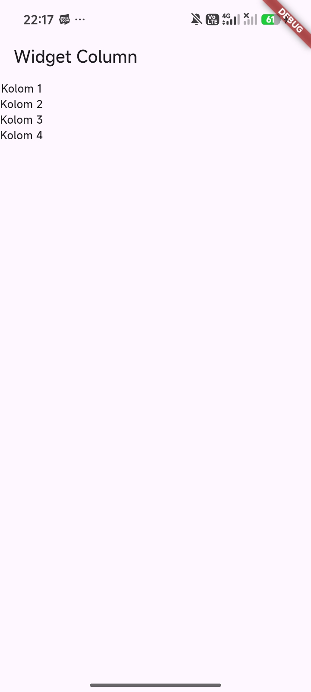
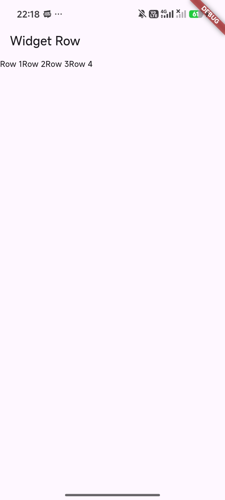
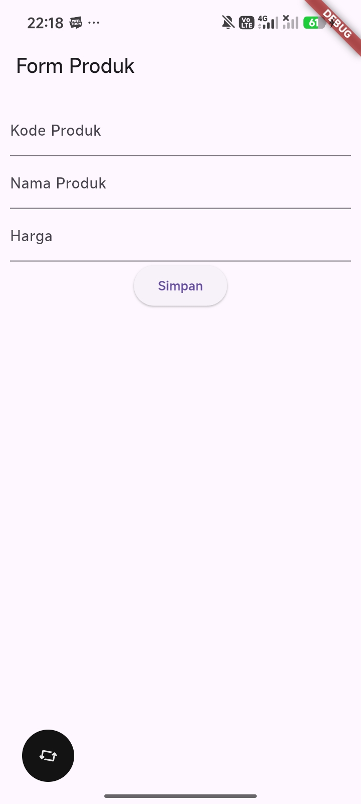
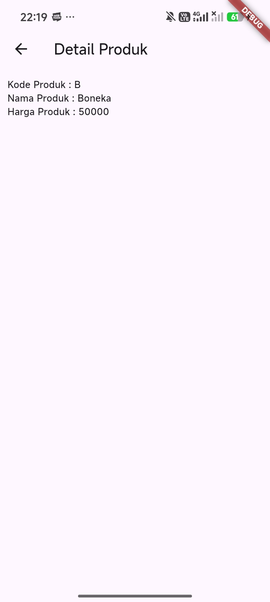
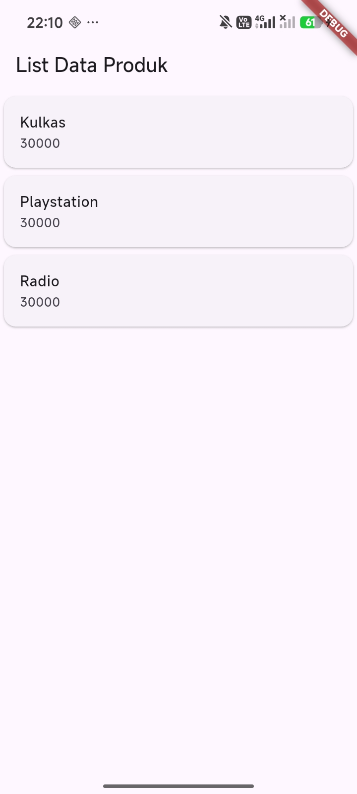

# Modul 2: Pengenalan dan Desain Framework Flutter

Repositori dan project ini dibuat untuk memenuhi tugas **Modul 2: Pengenalan dan Desain Framework Flutter** pada mata kuliah **Praktikum Pemrograman Mobile**.

---

## Identitas Praktikan

- **Nama       :** Amalia Maharani Andessy
- **NIM        :** H1D024032
- **Shift KRS  :** E
- **Shift Baru :** F

---

## Deskripsi Praktikum

Praktikum Modul 2 berfokus pada pengenalan dasar framework **Flutter** dan bahasa pemrograman **Dart** untuk membangun antarmuka pengguna (UI) mobile multiplatform. Pada modul ini dipelajari konsep-konsep fundamental:

1. **StatelessWidget & StatefulWidget**:
   - `StatelessWidget`: Widget statis yang propertinya tidak dapat berubah setelah diinisialisasi (misal: Text, Icon, StatelessWidget dasar).
   - `StatefulWidget`: Widget dinamis yang memiliki state internal yang dapat berubah sewaktu-waktu merespons interaksi pengguna atau data baru (misal: TextField, CheckBox, Form).
2. **Modularitas Kode (Multiple `.dart` files)**:
   - Memisahkan komponen UI ke dalam file terpisah agar kode rapi, modular, dan mudah dipelihara (*clean code*).
3. **Layouting Dasar**:
   - `Column`: Menata widget secara vertikal dari atas ke bawah.
   - `Row`: Menata widget secara horizontal dari kiri ke kanan.
4. **Input Form & State Management**:
   - Menggunakan `TextField` dengan `TextEditingController` untuk menangkap input data pengguna pada Form Produk.
5. **Navigasi & Passing Data**:
   - Berpindah halaman menggunakan `Navigator.push` dan `MaterialPageRoute`, serta mengirimkan parameter data (`kodeProduk`, `namaProduk`, `harga`) ke halaman detail.
6. **Menampilkan Data Koleksi (ListView & Card)**:
   - Menggunakan `ListView` dengan komponen `Card` dan `ListTile` untuk membuat daftar item produk.

---

## Struktur Folder Project

```text
modul2/
├── android/
│   ├── app/
│   └── gradle.properties      # Konfigurasi memori JVM Gradle
├── lib/
│   ├── hello_world.dart       # Latihan StatelessWidget dasar Hello World
│   ├── column_widget.dart     # Latihan Widget Column (tata letak vertikal)
│   ├── row_widget.dart        # Latihan Widget Row (tata letak horizontal)
│   ├── main.dart              # Entry point aplikasi (MaterialApp)
│   └── ui/
│       ├── produk_form.dart   # Form input data produk (StatefulWidget)
│       ├── produk_detail.dart # Halaman detail penerima data produk
│       └── produk_page.dart   # Daftar produk dengan ListView & Card
├── pubspec.yaml               # Konfigurasi dependensi project
└── README.md                  # Dokumentasi project Modul 2
```

---

## Rincian File dan Komponen

### 1. `lib/hello_world.dart` (Modul Hal. 16–18)
- Mengimplementasikan `StatelessWidget` bernama `HelloWorld`.
- Menggunakan widget `Scaffold` sebagai kerangka utama, `AppBar` dengan judul *"Belajar Flutter"*, dan `Center` yang membungkus `Text("Hello World")`.

### 2. `lib/column_widget.dart` (Modul Hal. 19–20)
- Mengimplementasikan `StatelessWidget` bernama `ColumnWidget`.
- Menggunakan widget `Column` yang menampung daftar anak (*children*) berupa 4 buah teks (`Kolom 1` s.d. `Kolom 4`) yang tersusun ke bawah secara vertikal.

### 3. `lib/row_widget.dart` (Modul Hal. 21)
- Mengimplementasikan `StatelessWidget` bernama `RowWidget`.
- Menggunakan widget `Row` yang menampung daftar anak (*children*) berupa 4 buah teks (`Row 1` s.d. `Row 4`) yang tersusun ke samping secara horizontal.

### 4. `lib/ui/produk_form.dart` & `lib/ui/produk_detail.dart` (Modul Hal. 21–24)
- **`ProdukForm` (`StatefulWidget`)**:
  - Memiliki tiga `TextField` untuk memasukkan **Kode Produk**, **Nama Produk**, dan **Harga**.
  - Menggunakan `TextEditingController` (`_kodeProdukController`, `_namaProdukController`, `_hargaProdukController`) untuk mengambil nilai teks.
  - Memiliki tombol `ElevatedButton` *"Simpan"* yang melakukan parsing harga ke tipe integer, lalu membuka halaman `ProdukDetail` melalui:
    ```dart
    Navigator.of(context).push(
      MaterialPageRoute(
        builder: (context) => ProdukDetail(
          kodeProduk: kodeProduk,
          namaProduk: namaProduk,
          harga: harga,
        ),
      ),
    );
    ```
- **`ProdukDetail` (`StatelessWidget`)**:
  - Menerima parameter `kodeProduk`, `namaProduk`, dan `harga`.
  - Menampilkan kembali nilai data produk yang dimasukkan oleh pengguna ke layar.

### 5. `lib/ui/produk_page.dart` (Modul Hal. 25–26)
- Mengimplementasikan `StatefulWidget` bernama `ProdukPage`.
- Menggunakan widget `ListView` yang berisi kumpulan `Card` dan `ListTile` untuk menampilkan daftar produk (*Kulkas*, *Playstation*, dan *Radio*) beserta informasinya.

### 6. `lib/main.dart` (Modul Hal. 26)
- Titik masuk utama aplikasi yang menjalankan `MyApp`.
- Secara default, properti `home:` pada `MaterialApp` menampilkan `ProdukPage()` sesuai instruksi penutup Modul 2.

---

## Cara Menjalankan Aplikasi

1. Hubungkan perangkat smartphone (aktifkan *USB Debugging*) atau jalankan emulator Android.
2. Buka terminal pada folder `modul2`:
   ```powershell
   cd modul2
   ```
3. Jalankan perintah:
   ```powershell
   flutter run
   ```
   *Atau buka file `lib/main.dart` di VS Code / Antigravity IDE, lalu tekan tombol **F5** (Run Without Debugging).*

---

## Cara Mengganti Halaman Pengujian di `main.dart`

Untuk menguji dan menampilkan masing-masing latihan yang ada di Modul 2, cukup ubah satu baris pada nilai `home:` di file `lib/main.dart`:

```dart
// 1. Tampilan Hello World (Hal. 16-18)
home: const HelloWorld(),

// 2. Tampilan Widget Column (Hal. 19-20)
home: const ColumnWidget(),

// 3. Tampilan Widget Row (Hal. 21)
home: const RowWidget(),

// 4. Tampilan Form Input Produk (Hal. 21-24)
home: const ProdukForm(),

// 5. Tampilan ListView Produk (Hal. 25-26 - Default Aktif)
home: const ProdukPage(),
```
Setelah mengubah baris tersebut dan menyimpannya (**Ctrl + S**), tekan tombol **r** (*Hot Reload*) di terminal untuk melihat perubahannya langsung di layar HP.

---

## Hasil Tangkapan Layar (Screenshots)

Simpan hasil screenshot dari layar HP ke dalam folder `screenshots/` di root repositori dengan format nama file di bawah ini:

### 1. Tampilan Hello World (Modul Hal. 17)


### 2. Tampilan Widget Column (Modul Hal. 20)


### 3. Tampilan Widget Row (Modul Hal. 21)


### 4. Tampilan Form Input Produk (Modul Hal. 22–23)


### 5. Tampilan Detail Produk Setelah Input (Modul Hal. 24)


### 6. Tampilan ListView Data Produk (Modul Hal. 26)

