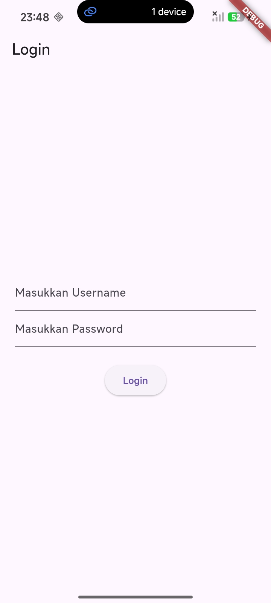
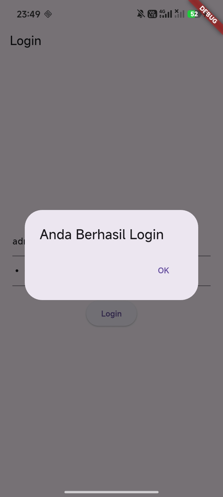
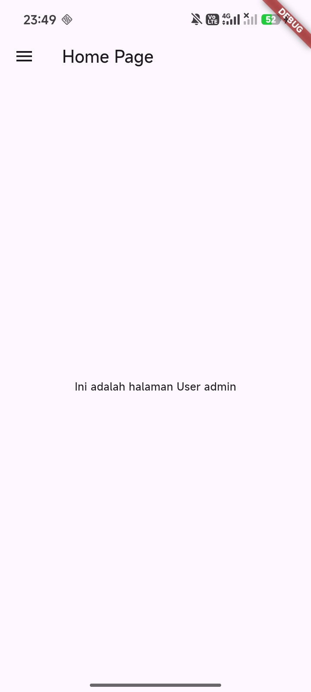
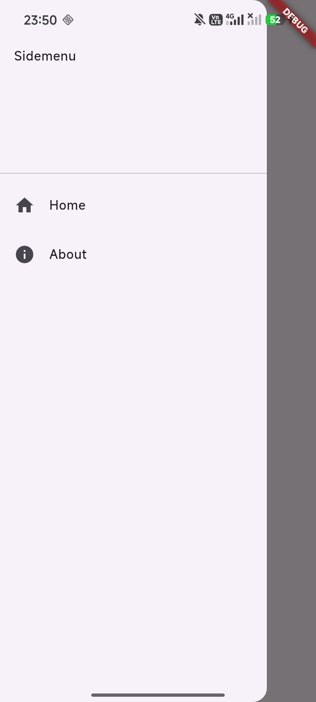
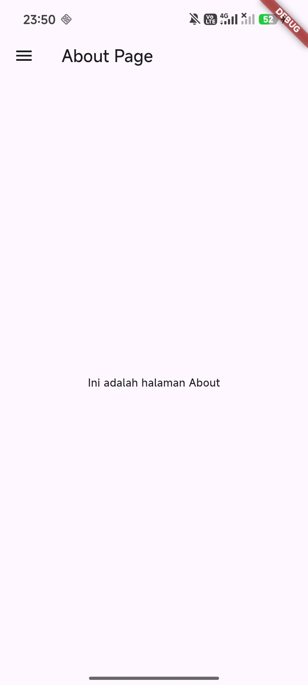

# Modul 3: Routes, Side Menu, Login dan Local Storage Framework Flutter

Repositori dan project ini dibuat untuk memenuhi tugas **Modul 3: Routes, Side Menu, Login dan Local Storage Framework Flutter** pada mata kuliah **Praktikum Pemrograman Mobile**.

---

## Identitas Praktikan

- **Nama       :** Amalia Maharani Andessy
- **NIM        :** H1D024032
- **Shift KRS  :** E
- **Shift Baru :** F

---

## Deskripsi Praktikum

Praktikum Modul 3 berfokus pada implementasi alur autentikasi pengguna, penyimpanan data lokal di perangkat, dan pembuatan navigasi menu samping (*drawer / sidemenu*). Materi utama yang dipelajari meliputi:

1. **Autentikasi Sederhana (Login System)**:
   - Membuat halaman login dengan input `username` dan `password` (`obscureText: true`).
   - Simulasi validasi kredensial (username: `admin` dan password: `admin`).
   - Menampilkan umpan balik menggunakan dialog peringatan (`AlertDialog`).
2. **Local Storage Menggunakan `shared_preferences`**:
   - Menyimpan data username pengguna ke penyimpanan lokal perangkat (`prefs.setString('username', ...)`).
   - Membaca kembali data username yang tersimpan untuk ditampilkan pada halaman beranda (`prefs.getString('username')`).
3. **Navigasi Antar Halaman (*Routing*)**:
   - Berpindah antar halaman aplikasi menggunakan `Navigator.push` dan `MaterialPageRoute`.
4. **Side Menu / Drawer (*Navigation Drawer*)**:
   - Membuat menu navigasi samping (`Drawer`) dengan `DrawerHeader` dan beberapa `ListTile`.
   - Menghubungkan menu navigasi ke halaman **Home** dan **About**.

---

## Struktur Folder Project

```text
modul3/
├── android/
│   ├── app/
│   └── gradle.properties      # Konfigurasi memori JVM Gradle aman (2GB)
├── lib/
│   ├── main.dart              # Entry point aplikasi (MaterialApp & rute awal)
│   ├── login_page.dart        # Halaman Login & penyimpanan SharedPreferences
│   ├── home_page.dart         # Halaman Utama (menampilkan user & drawer)
│   ├── sidemenu.dart          # Komponen Drawer menu samping (Home & About)
│   └── about_page.dart        # Halaman About dengan komponen Drawer
├── pubspec.yaml               # Dependensi shared_preferences
└── README.md                  # Dokumentasi project Modul 3
```

---

## Rincian File dan Logika Program

### 1. `pubspec.yaml`
Menambahkan dependensi pustaka penyimpanan lokal:
```yaml
dependencies:
  flutter:
    sdk: flutter
  cupertino_icons: ^1.0.8
  shared_preferences: ^2.0.17
```

### 2. `lib/login_page.dart` (Modul Hal. 2–5)
- Menggunakan `StatefulWidget` dengan dua `TextEditingController`:
  - `_usernameController`: Input username.
  - `_passwordController`: Input password.
- **Fungsi `_saveUsername()`**:
  Menyimpan username ke penyimpanan lokal menggunakan `SharedPreferences`:
  ```dart
  void _saveUsername() async {
    SharedPreferences prefs = await SharedPreferences.getInstance();
    prefs.setString('username', _usernameController.text);
  }
  ```
- **Fungsi `_showDialog()`**:
  Menampilkan pop-up peringatan interaktif (`AlertDialog`).
- **Logika Tombol Login**:
  Jika kredensial adalah `admin` / `admin`, data username disimpan dan pengguna dialihkan ke `HomePage`. Jika salah, muncul peringatan dan tetap berada di `LoginPage`.

### 3. `lib/home_page.dart` (Modul Hal. 7–8)
- Menampilkan pesan sambutan yang memuat username aktif dari penyimpanan lokal:
  ```dart
  Text('Ini adalah halaman User $namauser')
  ```
- Mengambil username saat inisialisasi (`_loadUsername()`) dengan `prefs.getString('username')`.
- Memasang komponen menu samping pada properti `drawer: const Sidemenu()`.

### 4. `lib/sidemenu.dart` (Modul Hal. 9, 11)
- Berisi widget `Drawer` dengan `ListView` yang memuat:
  - `DrawerHeader`: Menampilkan judul menu *"Sidemenu"*.
  - `ListTile` Home: Navigasi menuju `HomePage`.
  - `ListTile` About: Navigasi menuju `AboutPage`.

### 5. `lib/about_page.dart` (Modul Hal. 10)
- Menampilkan halaman informasi dengan teks *"Ini adalah halaman About"*.
- Tetap menyertakan `drawer: const Sidemenu()` agar navigasi samping tetap konsisten di seluruh halaman aplikasi.

### 6. `lib/main.dart` (Modul Hal. 6–7)
- Menjalankan root widget `MyApp` dengan halaman awal diarahkan langsung ke `LoginPage`:
  ```dart
  home: const LoginPage(),
  ```

---

## Cara Menjalankan Aplikasi

1. Buka terminal pada folder `modul3`:
   ```powershell
   cd modul3
   ```
2. Jalankan aplikasi ke perangkat HP yang terhubung atau emulator:
   ```powershell
   flutter run
   ```
   *Atau buka file `lib/main.dart` di VS Code / Antigravity IDE, lalu tekan tombol **F5** (Run Without Debugging).*
3. Masuk dengan akun uji coba:
   - **Username :** `admin`
   - **Password :** `admin`

---

## Hasil Tangkapan Layar (Screenshots)

Simpan hasil screenshot dari layar HP ke dalam folder `screenshots/` di root repositori dengan format nama file berikut:

### 1. Halaman Login (Modul Hal. 6)
> Letakkan screenshot di: `screenshots/modul3_login.png`



### 2. Dialog Berhasil Login
> Letakkan screenshot di: `screenshots/modul3_dialog_login.png`



### 3. Halaman Home Page (Modul Hal. 12)
> Letakkan screenshot di: `screenshots/modul3_home.png`



### 4. Tampilan Side Menu / Drawer Terbuka (Modul Hal. 12)
> Letakkan screenshot di: `screenshots/modul3_sidemenu.png`



### 5. Halaman About Page
> Letakkan screenshot di: `screenshots/modul3_about.png`


